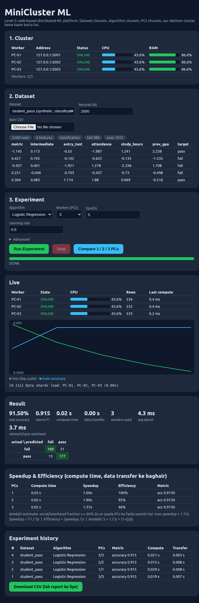
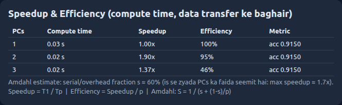
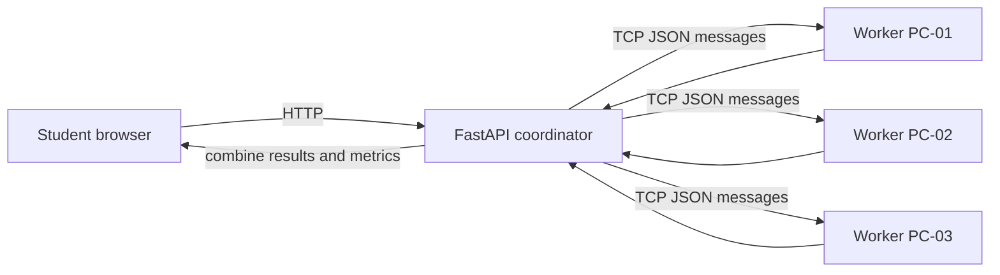

# MiniCluster ML — Distributed Computing Lab

**Teen lab computers ko network ke zariye ek chhota distributed-computing cluster banayein, aur browser se parallel tasks aur machine-learning experiments chalayein.** Yeh project P&DC ke Socket Programming, Multithreading, distributed memory, gradient aggregation, fault tolerance, load balancing, speedup aur Amdahl's Law jaise topics ko hands-on demonstrate karta hai.

> **Teaching scenario:** “Ek bara kaam ek computer par karne ke bajaye, hum use network ke zariye teen computers mein baantte hain. Har computer apna hissa process karta hai aur coordinator results jor kar final jawab deta hai.”

## Dashboard screenshots

Dashboard mein cluster health, dataset preview, training progress, worker-level activity, metrics aur experiment history nazar aati hai.



Compare feature 1, 2 aur 3 workers ke compute time, speedup, efficiency aur estimated serial/overhead fraction ko side-by-side dikhata hai.



## System architecture



Workers ki memory alag hoti hai; yeh project un computers ki RAM/CPU ko ek virtual computer mein merge nahi karta. Coordinator data ya tasks distribute karta hai, workers apne paas computation karte hain, aur messages ke zariye results wapas bhejte hain.

## Learning path: three levels

| Folder | Level | Experiment | Concepts |
|---|---:|---|---|
| `level1_basic/` | 1 | 1 se N tak numbers ke squares workers mein baantna | TCP sockets, threads, range partitioning, timing, speedup |
| `level2_regression/` | 2 | Student performance ke liye distributed linear regression | Data sharding, gradient aggregation, synchronization, worker failure recovery |
| `level3_platform/` | 3 | Browser-based distributed ML platform | Built-in/CSV datasets, Logistic/Linear Regression, Random Forest, load balancing, metrics, experiment history |

Har level independently run hota hai aur uski apni `README.md` mein level-specific instructions hain. **Final demo ke liye Level 3** recommend kiya gaya hai; Levels 1 aur 2 concepts ko pehle asaan tareeqe se sikhate hain.

## Level 3 features

- **Datasets:** synthetic `student_pass` aur `student_score`; scikit-learn `iris`, `wine`, `breast_cancer`, `digits`, `diabetes`; apni CSV upload.
- **Algorithms:** classification ke liye Logistic Regression aur Random Forest; regression ke liye Linear Regression aur Random Forest.
- **Metrics:** classification accuracy, macro-F1, confusion matrix; regression R², RMSE, MAE.
- **Live dashboard:** worker online/offline, CPU/RAM, per-worker rows/tasks, training curve, event log aur job phase.
- **Comparison:** 1/2/3 workers par run, compute-time comparison, speedup, efficiency aur Amdahl estimate.
- **Resilience:** gradient-descent worker fail ho to shards reassign; Random Forest worker fail ho to uske tasks dobara schedule.
- **Load balancing:** Random Forest ka task queue free worker ko agla tree-batch deta hai; `--slow` se heterogeneous workers simulate kar sakte hain.
- **History:** experiments browser mein list hote hain aur CSV lab report ke liye download ho sakti hai.

## Quick start — Level 3 (one computer simulation)

Python 3.10+ recommend hai. Commands ko **Level 3 directory** mein chalayein:

```bash
cd level3_platform
python3 -m venv .venv
source .venv/bin/activate          # Windows PowerShell: .venv\Scripts\Activate.ps1
python -m pip install -r requirements.txt
```

Ab chaar terminals kholein. Har terminal mein `cd level3_platform` karein aur virtual environment activate karein.

**Terminal 1 — Worker 1:**

```bash
python worker.py --host 127.0.0.1 --port 5001
```

**Terminal 2 — Worker 2:**

```bash
python worker.py --host 127.0.0.1 --port 5002
```

**Terminal 3 — Worker 3:**

```bash
python worker.py --host 127.0.0.1 --port 5003
```

**Terminal 4 — Coordinator:**

```bash
python -m uvicorn coordinator:app --host 127.0.0.1 --port 8000
```

Browser mein [http://127.0.0.1:8000](http://127.0.0.1:8000) kholein. Cluster card mein `3/3` online workers dikhne chahiye. Dashboard se dataset, algorithm aur worker count select karke **Run Experiment** dabayein.

> One-computer setup mein teen alag worker processes chalte hain; yeh **three physical computers ka performance benchmark nahi** hai. Is setup ka maqsad functionality aur teaching demo hai.

## Teen physical lab PCs par setup

1. Teeno PCs ko ek hi trusted LAN/Wi-Fi par connect karein. Level 3 folder har machine par copy karein aur `pip install -r requirements.txt` se dependencies install karein.
2. Har worker PC ka LAN IPv4 address note karein. Windows par `ipconfig`, Linux par `ip addr` ya `hostname -I` use kar sakte hain.
3. Har worker PC par port `5001` ka worker start karein:

	```bash
	python worker.py --host 0.0.0.0 --port 5001
	```

4. Coordinator PC ke `level3_platform/workers.json` mein example addresses ko apne actual worker IPs se replace karein:

	```json
	[
	  {"name": "PC-01", "host": "192.168.1.11", "port": 5001},
	  {"name": "PC-02", "host": "192.168.1.12", "port": 5001},
	  {"name": "PC-03", "host": "192.168.1.13", "port": 5001}
	]
	```

5. Coordinator par app ko LAN interface par start karein:

	```bash
	python -m uvicorn coordinator:app --host 0.0.0.0 --port 8000
	```

6. Coordinator PC ka port `8000` aur worker PCs ke port `5001` ko OS firewall mein **sirf trusted lab network** ke liye allow karein. Browser se `http://<coordinator-ip>:8000` kholein.

`workers.json` ke default addresses `127.0.0.1` hain aur woh local demo ke liye hain. Real cluster use karte waqt unhein zaroor update karein. Is teaching prototype mein authentication/TLS configured nahi; isay public internet par expose na karein.

## Algorithm aur data flow

### Level 1 — Distributed squares

Coordinator `1..N` ko nearly equal ranges mein divide karta hai. Har worker apne range ke squares TCP request par calculate karta hai. Coordinator ordered results concatenate karke correctness, per-worker time aur total time report karta hai.

### Level 2 — Synchronized gradient descent

Training data workers ke shards mein load hota hai. Har epoch mein coordinator current weights bhejta hai, workers apne shards par gradients nikalte hain, aur coordinator gradients ko row-count ke mutabiq combine karke weights update karta hai. Kisi worker ke fail hone par remaining workers ko data re-shard karke epoch retry hota hai.

### Level 3 — Model training

- **Linear/Logistic Regression:** synchronized data-parallel gradient descent; training data worker shards mein hota hai. Per-epoch synchronization ka network cost bhi measure hota hai.
- **Random Forest:** workers ko tree-batch tasks diye jate hain; har worker ko full training data chahiye. Free worker queue se agla batch leta hai. Worker fail hone par uske incomplete/lost tasks dobara train hote hain.
- **CSV preprocessing:** target column choose karein. Numeric features use hote hain; text/ID-like feature columns preview mein excluded dikhte hain; missing numeric values column mean se fill hote hain. Target classification/regression selection ko task dropdown se override kiya ja sakta hai.

## Classroom demos aur student questions

1. **Basic distribution:** Level 1 par N barhayein aur `Compare 1 / 2 / 3 PCs` chalayein. Work factor ko kam/zyada karke communication overhead compare karein.
2. **Gradient synchronization:** Level 2 par 1, 2, 3 workers se run karein. Learned weights aur closed-form reference dekhein.
3. **ML comparison:** Level 3 par `student_pass` ke saath Logistic Regression aur Random Forest compare karein; regression ke liye `student_score` aur Linear Regression chun sakte hain.
4. **CSV experiment:** Apni CSV upload karein, target select karein, preview mein excluded columns/target labels dekhein, phir training run karein.
5. **Load balancing:** ek worker `python worker.py --port 5001 --slow 4` se start karein. Random Forest tasks mein workers ke task counts compare karein.
6. **Fault tolerance:** training ke dauran worker process ko band karein. Event log mein offline/reassignment messages observe karein.
7. **Amdahl's Law:** chhote aur bare datasets par 1/2/3 workers compare karein. Zyada workers hamesha linear speedup kyun nahi dete?
8. **Lab report:** experiment history mein CSV download karein.

Useful formulas: speedup $S_p = T_1/T_p$; efficiency $E_p = S_p/p$. Amdahl model mein $S_p = 1/(s+(1-s)/p)$, jahan $s$ serial/overhead fraction aur $p$ worker count hai.

Student discussion:

- Teen PCs par runtime exactly one-third kyun nahi hota?
- Chhoti dataset par network/synchronization ka relative impact kyun zyada ho sakta hai?
- Gradient descent mein har epoch ke baad synchronization kis liye hoti hai?
- Random Forest task scheduling mein slow worker cluster ki completion time ko kaise affect karta hai?
- Distributed workers ki separate memory ka kya matlab hai? Kya woh ek single RAM pool ban jati hai?

## P&DC concepts ka mapping

| Course concept | Project mein demonstration |
|---|---|
| TCP socket programming | Coordinator aur worker ke darmiyan length-prefixed JSON messages; Level 3 mein `common.py` |
| Multithreading | Workers concurrent client connections handle karte hain; coordinator workers ko parallel call karta hai |
| Distributed memory | Har worker apni process/machine ki memory mein data rakhta hai; communication explicit hoti hai |
| Reduce / aggregation | Gradient vectors coordinator par sum/average hote hain |
| Task vs data parallelism | Regression mein data shards; Random Forest mein independent tree batches |
| Load balancing | Random Forest ke idle workers queue se agla task uthate hain |
| Fault tolerance | Worker disconnect hone par shards/tasks remaining workers ko dobara milte hain |
| Speedup / efficiency | Dashboard 1/2/3 worker timings compare karta hai |
| Amdahl's Law | Comparison panel serial/overhead fraction ka estimate dikhata hai |
| Shared-memory local parallelism | Random Forest mein `Cores / worker`; `MC_THREADS` BLAS/OpenMP thread count set karta hai |

## Project files

```text
MiniCluster/
├── README.md
├── docs/screenshots/
│   ├── dashboard-result.png
│   └── speedup-comparison.png
├── level1_basic/       # Level 1 app, worker, coordinator, UI, README
├── level2_regression/  # Level 2 app, worker, coordinator, data, README
└── level3_platform/    # Final platform, ML datasets, UI, README
```

Har level ke README mein file-by-file setup aur level-specific notes hain. Level 3 ka core code: `coordinator.py` (FastAPI, job scheduling, aggregation), `worker.py` (compute worker), `common.py` (socket/array messages), `datasets.py` (dataset preparation/metrics), `data.py` (synthetic data), `workers.json` (cluster addresses), `static/index.html` (dashboard).

## Troubleshooting

- **Worker OFFLINE:** pehle worker terminal process dekhein, address/port verify karein, phir coordinator ka `/api/status` refresh karein. Local test mein `workers.json` ke hosts `127.0.0.1` hone chahiye.
- **Port already in use:** port `8000` ya `5001` pehle se use ho raha ho to purana process band karein ya worker port aur `workers.json` dono update karein.
- **CSV preview error:** header ke saath kam az kam 10 valid data rows, kam az kam do columns, numeric feature column aur valid target select karein. File limit 100 MB hai.
- **Low speedup:** same-host workers asal multiple PCs nahi; chhote tasks par HTTP/TCP setup, data transfer, synchronization aur coordinator work runtime par haavi ho sakte hain.
- **Memory high:** synthetic dataset ka N kam karein; Random Forest mein tree count/depth aur worker core count ko bhi kam karke dekhein.
- **Different machine performance:** coordinator aur workers par CPU/core count, background load aur network latency same nahi honge; is liye measured time vary karega.

## Validation performed

Python modules compile kiye aur local three-worker cluster ke saath har level ka smoke test kiya. Level 1 distributed squares; Level 2 gradient aggregation; Level 3 Logistic Regression, Linear Regression, Random Forest, CSV upload, dashboard APIs aur history CSV export verify kiye. Dashboard browser mein khol kar three workers online aur training result visible hone ki tasdeeq ki.

## Further extensions

`mpi4py` ke saath MPI `Allreduce`, worker auto-discovery, CSV feature selection, persistent experiment history, authenticated lab access, ya GPU workers jaise features future mein add kiye ja sakte hain.
